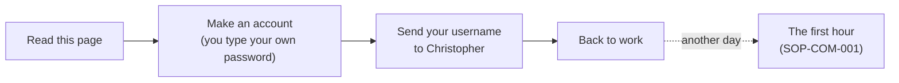

# Opening your gift

### For Jeff: what this GitHub thing is, in plain words, from your brother

*Read this one first. It takes five minutes, and it asks you for nothing.*

##  TL;DR

1.  **Wilson's Lawn Maintenance has been given a home on the internet, in its own name, with its logo and its photos already in it.** That place is called GitHub.
2.  **You owe nothing and you don't have to learn anything.** The business runs exactly as it does today: the phone, the Facebook page, the truck. If this sits untouched for a year, it waits.
3.  **Your first ten minutes:** make an account, type your own password, send your username to Christopher. Then back to work.
4.  **Your password is only yours.** Nobody who is really helping you will ever ask for it, or for a code sent to your phone. Not your brother, not any helper.
5.  **It can grow, if you want it to.** There's a look ahead further down, including the word you've been curious about. It's optional, like everything here.

##  What GitHub is, in plain words

Think of the folder for a big landscaping job: the estimate, the sketch of the beds, the mulch order, the day it was
done, the photo at the end. Now picture that folder keeping every earlier version too, never getting lost, and nobody ever
writing over the estimate by accident.

**GitHub is that folder, on the internet.** It's where people who build websites and software keep their work. You
already know how it runs, because it's how a job runs:

| | On a job | On GitHub | What it means |
|---|---|---|---|
|  | The job folder | a **repository** | one project, with every version kept |
|  | An estimate sent for the customer's OK | a **pull request** | a change, waiting for someone to say yes |
|  | The customer signing it | a **merge** | the yes. Nothing goes on the ground before this |
|  | A sketch of a new bed, beside the yard as it is | a **branch** | try it out without touching the real one |
|  | A note on the job ticket | an **issue** | a question or a thought, kept with the job |

You don't need to know how to program to own one, or to read what's in it.

##  What you have been given

A home for the business, set up by Christopher and his helpers, in the business's name:

| | What | In plain words |
|---|---|---|
|  | [`WILSONSLAWNMAINTENANCE`](https://github.com/WILSONSLAWNMAINTENANCE), the business's home on GitHub | the building, with your name on the door and you as an owner |
|  | [The brand assets](https://github.com/WILSONSLAWNMAINTENANCE/brand-assets) | your logo and the photos from your Facebook page, kept in one place, with a page saying who may use them and who may not |
|  | [The reading room](https://github.com/WILSONSLAWNMAINTENANCE/reading-room) | the back office: everything written for the business, each page with a PDF beside it |
|  | [The public reading room](https://WILSONSLAWNMAINTENANCE.github.io/reading-room-public/) | the front window: only what's been listed for visitors |
|  | Procedures | how each thing is done, step by step, like a checklist on the dash |
|  | Proposals | ideas offered, never asked. "Not now" is a complete answer, and so is silence |
|  | A legal folder | a private place for paperwork, if the business ever wants one: nothing in it yet, nothing in it is advice |
|  | A second owner | a spare key, held by Christopher, so the place never depends on one person, you included |

##  What to expect

**What will happen**
-  Once you send your username, an email from GitHub, inviting you to join `WILSONSLAWNMAINTENANCE`. It waits for you.
-  Some more emails, when things change. You can turn these down in GitHub's settings, or ignore them.
-  You may see AI helpers named in the history, like Alfred and Littlebird. They do the typing; a person says yes to what they prepare.

**What won't happen**
-  No bill. GitHub's free plan is all this needs.
-  Nothing leaves the back office by being written there. A page reaches the front window only after it's listed and a check has read it.
-  Nobody asks for your password, a sign-in code, or your bank login. Not Christopher, not any helper.
-  Nothing about customers. No names, no addresses, no prices go in here, by rule.

And wanting anything changed is still **one message to Christopher.** You never need GitHub for that.

##  Your first ten minutes

1. Go to `https://github.com/signup` and enter **your own** email address. *You should see:* a page asking for a password.
2. **Type a password of your own.** Nobody else types it, sees it or keeps it. *You should see:* a box asking for a username.
3. Choose a username. It's public and it lasts, so pick one you'd be happy to see on the side of the truck. *You should see:* a puzzle, or a code sent to your email.
4. Enter the code and choose the **Free** plan. *You should see:* a nearly empty page, with a little patterned picture at the top right.
5. Send **only your username** to Christopher, wherever you already talk.

That's all for today. When you have an hour, [SOP-COM-001, *New to GitHub: your first hour*](https://github.com/WILSONSLAWNMAINTENANCE/ops-standard-operating-procedures-public/blob/main/COM/SOP-COM-001-new-to-github-your-first-hour.md)
goes on from here, one step at a time: two-factor sign-in, accepting the invitation, five words, and reading your room
in a browser. Nothing in it asks you to type a command.

##  What you might be wondering

| | Question | Answer |
|---|---|---|
|  | Can I break it? | Reading can't break anything. A change waits for a sign-off, like an estimate, and a signed-off change can be taken back, which is more than you can say for a bed once the mulch is down. |
|  | Is it really mine? | You're an owner, so you see everything and decide who else can. The second owner is a spare key, not a landlord. |
|  | Do I need to learn to code? | No. Most of it is pages you read. |
|  | What if it's the busy season and I ignore it? | It waits. Nothing expires because you were out mowing. |
|  | What if the people who set this up move on? | That's why there are two owners. Everything is ordinary files you can download, and anyone you hire can read them. |
|  | Someone is asking for my password or a code. | The answer is no, whoever they say they are. Tell Christopher. |

##  What it could become

> [!IMPORTANT]
> **This part is a picture of what's possible, not a plan and not advice.** Nothing here is built for the business, nothing
> here is needed, and some of it may never arrive. It isn't financial, tax or legal advice. Your bank, your accounts and your
> prices aren't part of it, and nothing here says what to buy, hold or sell. Ask a professional before anything involving
> money or ownership.

You've mentioned being curious about crypto. Set aside the coins and the noise, and the idea underneath **web3** is simple:
some records can live on a shared public ledger instead of inside one company's database, so nobody has to take a single
company's word for who owns what, or who agreed to what.

A small business may be better placed for that than you'd expect, because you already run on estimates and sign-offs:

| | What you have today | What it's practice for | What it could grow into, if you ever want it |
|---|---|---|---|
|  | Every change on record, and who made it | Records you don't take on trust | A finished job with a record a later buyer of the property can check for themselves |
|  | Your own sign-in, that only you hold | Holding your own keys | A wallet for the business: a key that only you hold |
|  | Two owners, so nobody is a single point of failure | Shared control | Two signatures before anything moves |
|  | Proposals, decided by you | Deciding on the record | Whatever you decide, written down with the date |

**Curious about the words?** The reading room has a page for exactly that, [*The words of web3*](https://github.com/WILSONSLAWNMAINTENANCE/reading-room/blob/main/web3/the-words-of-web3.md):
wallet, seed phrase, hot and cold, and the handful of things a person who holds coins should never type into a website.
It explains; it doesn't advise. Beside it sits [*Before you connect a wallet*](https://github.com/WILSONSLAWNMAINTENANCE/reading-room/blob/main/web3/before-you-connect-a-wallet.md),
a short readiness check for the day one is ever wanted.

**What stays true however far this goes:** you decide, you keep your own keys, and "not now" is always a complete answer.

---

Written for Jeff by his brother's lab. Icons: Lucide (ISC). The first-hour procedure this page leads to is [SOP-COM-001](https://github.com/WILSONSLAWNMAINTENANCE/ops-standard-operating-procedures-public/blob/main/COM/SOP-COM-001-new-to-github-your-first-hour.md). The same page is on slides: [open the deck](decks/opening-your-gift.marp.pdf) (source: [`decks/opening-your-gift.marp.md`](decks/opening-your-gift.marp.md)), and this page is also a [PDF](OPENING-YOUR-GIFT.pdf).
