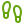
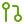

<!-- readme-standard: 2026-11-02 -->

# Wilson's Lawn Maintenance: .github

*The organisation's profile, its welcome decks, and the defaults every repository here shares.*

 **You are here:** Wilson's Lawn Maintenance › `.github` · public · `main` is the working branch

##  TL;DR

1.  **What this is.** The repository behind [the organisation page](https://github.com/WILSONSLAWNMAINTENANCE): GitHub shows [`profile/README.md`](profile/README.md) there.
2.  **Who it is for.** Anyone who arrives at the business's home on GitHub, and anyone changing the pages every repository here shares.
3.  **Do this first.** Jeff? [`OPENING-YOUR-GIFT.md`](OPENING-YOUR-GIFT.md). Visiting? [The organisation page](https://github.com/WILSONSLAWNMAINTENANCE). Joined? [`ONBOARDING.md`](ONBOARDING.md).

##  What is inside

| | Where | What it holds |
|---|---|---|
|  | [`profile/`](profile/) | the organisation page GitHub shows, with its banner and icons |
|  | [`OPENING-YOUR-GIFT.md`](OPENING-YOUR-GIFT.md) | **read this one first:** what Jeff has been given, what to expect, and what it could become, in plain words |
|  | [`decks/`](decks/) | two short decks on slides: [*Opening your gift*](decks/opening-your-gift.marp.md) and the [welcome](decks/welcome.marp.md) in seven stops |
|  | [`ONBOARDING.md`](ONBOARDING.md) | for anyone who has joined: two-factor sign-in, connecting a helper, how the work is done |
|  | [`CONTRIBUTING.md`](CONTRIBUTING.md) | the default contributing guide for repositories here that have none of their own |
|  | [`SECURITY.md`](SECURITY.md) | how to report a security problem |
|  | [`TRADEMARKS.md`](TRADEMARKS.md), [`LICENSE`](LICENSE), [`LICENSE-CONTENT`](LICENSE-CONTENT) | code is MIT; written content is CC BY-SA 4.0; the business's name and marks belong to the business |

##  Suggest a change

Noticed something? Open an [issue](../../issues), or for a small fix a pull request against `main`; [`CONTRIBUTING.md`](CONTRIBUTING.md) says how, and asks that prices and customer details never go in one. Christopher and the drasticstatic lab read them, Jeff decides what is said about the business, and a person with the role merges with a merge commit. Not on GitHub? One message to Christopher is enough.

This front door follows the living [README standard](https://github.com/drasticstatic/my-template/blob/main/README-STANDARD.md). Copy it, improve it. Icons: Lucide (ISC), see <code>assets/icons/LICENSE</code>.
