  

  
  
  
  

##  Keeping it green

**Wilson's Lawn Maintenance** does lawn care in Glen Rock, PA and across York County: mowing, mulch beds, landscaping,
firewood, and snow removal when the season turns. The business is Jeffrey Wilson's. Reach it where it already lives, on
[Facebook](https://www.facebook.com/WilsonslawnmaintenancePA/), by phone at (717) 825-8432, or by email at
Wilsonj84321@gmail.com.

This is the business's home on GitHub: **a work in progress**, set up as a gift by Jeff's brother and kept ready for the
day the business wants it. Nothing here asks anything of a customer, and nothing here is needed to book a job.

-  **A gift, opened at the business's own pace:** [Opening your gift](https://github.com/WILSONSLAWNMAINTENANCE/.github/blob/main/OPENING-YOUR-GIFT.md) says what has been given, in plain words, and asks for nothing.
-  **Kept ready:** a private reading room, the business's procedures and its proposals, each a page with a PDF beside it.
-  **No single point of failure:** the business's seat here is an owner's, beside the lab's.

##  Decks, procedures and proposals

| | Where | What you'll find |
| --- | --- | --- |
|  | [Opening your gift, on slides](https://github.com/WILSONSLAWNMAINTENANCE/.github/blob/main/decks/opening-your-gift.marp.pdf) ([slides](https://github.com/WILSONSLAWNMAINTENANCE/.github/blob/main/decks/opening-your-gift.marp.html), [markdown](https://github.com/WILSONSLAWNMAINTENANCE/.github/blob/main/decks/opening-your-gift.marp.md)) | the gift in a few slides: what it is, what to expect, what it could become |
|  | [Welcome deck](https://github.com/WILSONSLAWNMAINTENANCE/.github/blob/main/decks/welcome.marp.pdf) ([slides](https://github.com/WILSONSLAWNMAINTENANCE/.github/blob/main/decks/welcome.marp.html), [markdown](https://github.com/WILSONSLAWNMAINTENANCE/.github/blob/main/decks/welcome.marp.md)) | the business's home in seven short stops, from a first GitHub account to a helper reading beside you |
|  | [Reading room, for visitors](https://WILSONSLAWNMAINTENANCE.github.io/reading-room-public/) | the public front page: what the business has chosen to share, and the door to the members' room |
|  | [Reading room, members](https://github.com/WILSONSLAWNMAINTENANCE/reading-room) | everything written for the business, for its owners and the readers they name (a 404 means "not yet", not "broken") |
|  | [Procedures](https://github.com/WILSONSLAWNMAINTENANCE/ops-standard-operating-procedures-public) | *this is how it is done*: the procedures the owner has listed for visitors |
|  | [SOP-COM-001, *New to GitHub: your first hour*](https://github.com/WILSONSLAWNMAINTENANCE/ops-standard-operating-procedures-public/blob/main/COM/SOP-COM-001-new-to-github-your-first-hour.md) | your own account and password, the invitation, five words, a helper; optional, always |
|  | Proposals | *ideas offered, never asked*: private to the owners, read through the reading room |
|  | [Gitmoji](https://github.com/drasticstatic/my-template/blob/main/GITMOJI.md) | every commit subject starts with one: `:sparkles: feat(scope): what changed` |

##  People

| | |
| --- | --- |
|  **Jeffrey Wilson** | the owner of Wilson's Lawn Maintenance, and the only one who decides what is said about it |
|  **Christopher W** ([@drasticstatic](https://github.com/drasticstatic)) | Jeff's brother; set this home up as a gift and keeps it, with his helpers Alfred ([Claude Code](https://drasticstatic.github.io/anthropas-argus-alfred-public-preview/)) and [Littlebird](https://drasticstatic.github.io/littlebird-ambassador-public-preview/). He is the second owner, so the place never depends on one person |

##  Repositories

| Repository | What it holds |
| --- | --- |
| [.github](https://github.com/WILSONSLAWNMAINTENANCE/.github) | this profile, the decks in `decks/`, and the defaults every repository here shares |
| [brand-assets](https://github.com/WILSONSLAWNMAINTENANCE/brand-assets) | the logo, the photos from the business's Facebook page, and who may use them |
| [reading-room-public](https://github.com/WILSONSLAWNMAINTENANCE/reading-room-public) | the reading room's public front page, and only the pages listed for visitors (copied in by a sync, never edited by hand) |
| [ops-standard-operating-procedures-public](https://github.com/WILSONSLAWNMAINTENANCE/ops-standard-operating-procedures-public) | the procedures listed for visitors (copied in by a sync, never edited by hand) |

Private, for the owners: `reading-room`, `ops-standard-operating-procedures`, `proposals`, `legal`. Their names are
public; their contents are not.

##  Community health

- [`OPENING-YOUR-GIFT.md`](https://github.com/WILSONSLAWNMAINTENANCE/.github/blob/main/OPENING-YOUR-GIFT.md): **never heard of GitHub? read this first**: what the business was given and the first ten minutes, in plain words
- [`ONBOARDING.md`](https://github.com/WILSONSLAWNMAINTENANCE/.github/blob/main/ONBOARDING.md): **joined the organisation? start here**: two-factor sign-in, a helper, how the work is done
- [`CONTRIBUTING.md`](https://github.com/WILSONSLAWNMAINTENANCE/.github/blob/main/CONTRIBUTING.md): how to contribute, and the Gitmoji commit subject
- [`SECURITY.md`](https://github.com/WILSONSLAWNMAINTENANCE/.github/blob/main/SECURITY.md): reporting a security problem

##  License

- **Code:** MIT, see [`LICENSE`](https://github.com/WILSONSLAWNMAINTENANCE/.github/blob/main/LICENSE)
- **Written content:** CC BY-SA 4.0, see [`LICENSE-CONTENT`](https://github.com/WILSONSLAWNMAINTENANCE/.github/blob/main/LICENSE-CONTENT)
- **The Wilson's Lawn Maintenance name, logo and marks:** the business's own, covered by neither licence, see [`TRADEMARKS.md`](https://github.com/WILSONSLAWNMAINTENANCE/.github/blob/main/TRADEMARKS.md)

---

Kept ready by the drasticstatic lab as a brother's gift. The business is welcome to reshape this space whenever it likes. Icons: Lucide (ISC).

